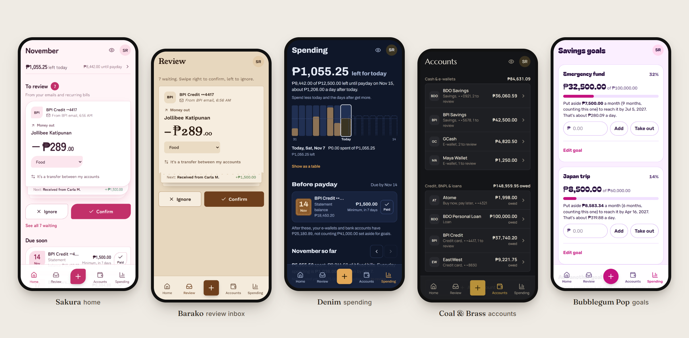
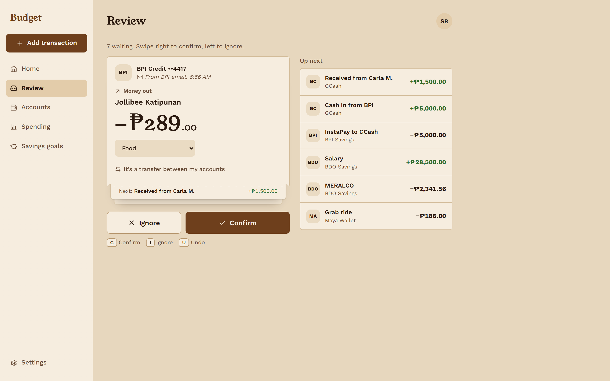
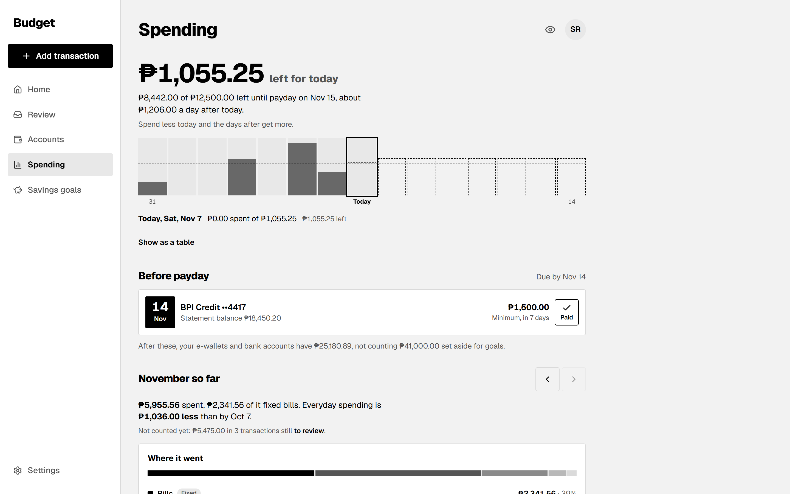

# Budget

A budgeting app for the way money moves in the Philippines. Bank and e-wallet notifications (emails, texts and app
alerts) become pending transactions on their own, and you review them in an inbox instead of typing every purchase.

**Live demo:** [budgetdemo.jadebonifacio.dev](https://budgetdemo.jadebonifacio.dev) · no sign-in, synthetic data,
your changes stay in your browser.



## Why it exists

No Philippine bank offers personal API access, and typing every Jollibee run into a spreadsheet lasts about a week.
What every bank and e-wallet does send is a notification for each transaction. Budget treats those as the source of
truth: they arrive as pending items, and a few taps a day keep the month accurate.

## What it does

- **Review inbox.** Captured transactions wait as cards you confirm, ignore or recategorise, by swipe, tap or
  keyboard (`C`, `I`, `U` to undo). Possible duplicates are flagged, and a transfer that shows up as money out of one
  account and money into another is matched into a single transfer.
- **Capture from email and phone.** Gmail filters forward bank emails to a private address; a Cloudflare Email Worker
  stores them and a separate, re-runnable job parses them. Android forwarder apps and iPhone Shortcuts send texts and
  app notifications to a per-phone secret link. Parsers exist for BPI, GCash, Atome, EastWest and SPayLater emails
  and BPI and GCash texts. A transfer both banks report, or a text whose stated balance matches, confirms itself
  and stays labelled so you can send it back to review.
- **What's due before what's spent.** Card statements, minimum payments, loan amortisation and BNPL installment
  schedules, with web push reminders.
- **A daily number.** Spending shows what you can spend today so the money lasts until payday, where the month went,
  repeating subscriptions, category limits and savings goals.
- **Honest balances.** Balance checkpoints compare the bank's stated balance with Budget's at that moment, and
  history imports add only what's missing (undoable).
- **Eight themes,** each with light and dark: Sakura, Strawberry Milk, Bubblegum Pop, Barako, Courtside, Denim,
  Monochrome, and Coal & Brass. Each has its own type, corners and colour, all built to WCAG AA contrast.
  Income and expense are never shown by colour alone.



## Privacy rules the code enforces

- Every user-owned table has row-level security, and pgTAP tests prove user A can't read or write user B's rows.
- Full card numbers are masked (Luhn check) before anything is stored, including inside raw emails.
- Only the last four digits of an account are kept. No bank passwords, no OTPs.
- Texts from unknown senders are recorded without their content, so personal messages are never kept.
- Money is integer centavos everywhere. Times are stored in UTC and shown in Asia/Manila.

## Stack

Next.js 16 (App Router, cache components) · React 19 · TypeScript · Supabase (Postgres, Auth, RLS) · Cloudflare
Email Worker · zod at every boundary · Tailwind 4 · Vitest · Playwright · pgTAP. Free tiers only, installable as a PWA.

## How the demo works

The demo is the same build with `NEXT_PUBLIC_DEMO_MODE=true`, and it has no backend. The server runs the real
migrations in-process with [PGlite](https://pglite.dev) (Postgres compiled to WebAssembly) and seeds a made-up user,
and a small PostgREST-compatible layer (`src/lib/demo/postgrest.ts`) answers supabase-js from it. Every trigger,
view and RPC is the production SQL, not a mock.

Each visitor's writes are kept as a compressed log in their own cookies. Database IDs come from a sequence instead
of randomness, so any serverless instance can replay a visitor's log onto the seeded snapshot and get the same rows
they saw. There is no shared state, and Reset just clears the cookies.



## Running it

Needs Node 22+, pnpm and Docker (for local Supabase).

```sh
pnpm install
pnpm db:start            # local Supabase: Postgres, Auth, Studio, Mailpit
cp .env.example .env.local
pnpm dev                 # http://localhost:3000
pnpm demo you@example.com  # fill that user's local data with the demo set
```

Or skip Docker entirely and run the demo build: `NEXT_PUBLIC_DEMO_MODE=true pnpm dev`.

## Checks

```sh
pnpm typecheck && pnpm lint && pnpm test   # 185 unit tests: parsers, money, reconciliation, the demo database
pnpm db:test                               # pgTAP: RLS isolation, transfers, auto-confirm, reconciliation
pnpm test:e2e                              # Playwright on phone and desktop against the local stack
```

Deployment, including the demo, is in [docs/DEPLOY.md](docs/DEPLOY.md).
